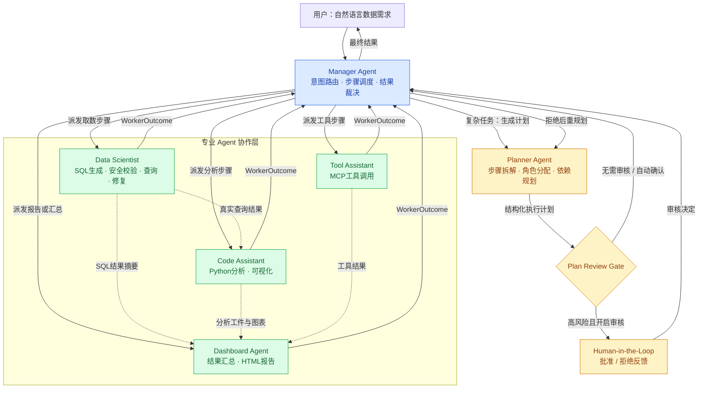
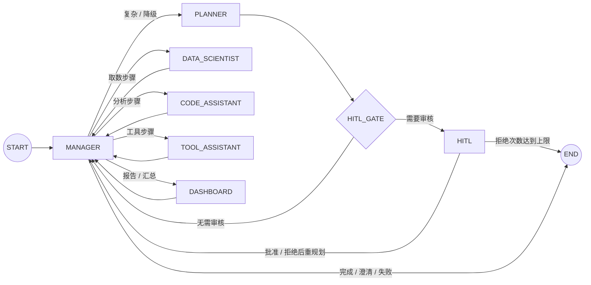
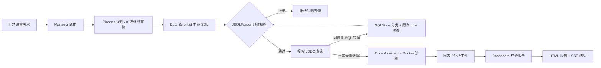

# ZZJ-NL2SQL · QueryForge

<p align="center">
  <strong>Multi-Agent 智能数据分析平台</strong><br>
  让自然语言需求经过任务规划、SQL 查询、Python 分析与报告生成，成为可追踪、可审核的业务分析结果
</p>

<p align="center">
  
  
  
  
  
  
  
  
</p>

<p align="center">
  <a href="https://github.com/zmzzj1/ZZJ-NL2SQL-front">前端项目</a> ·
  <a href="https://github.com/zmzzj1/ZZJ-NL2SQL-backend">后端项目</a> ·
  <a href="#-多-agent-协作架构">协作架构</a> ·
  <a href="#-核心技术设计">技术亮点</a> ·
  <a href="#-快速开始">快速开始</a>
</p>

---

## 📖 项目简介

**ZZJ-NL2SQL（QueryForge）** 是基于 **Spring Boot 3、Spring AI 与 Spring AI Alibaba Graph** 构建的智能数据分析平台。用户连接有权限访问的数据库后，可直接使用自然语言描述需求，平台通过 **Manager + Planner + 专业 Worker Agent** 协同完成业务理解、任务拆解、SQL 生成与验证、受控数据查询、Python 分析、图表展示及 HTML 报告生成。

平台将 **Agent 决策编排** 与 **Java 后端受控执行** 分开：大模型负责理解意图、生成计划及候选内容；实际的数据源访问、SQL 校验、查询执行、权限控制、资源限制、审批与结果持久化由确定性后端完成。既能处理简单的单 SQL 查询，也能处理具有步骤依赖的复杂分析任务。

**一个典型的请求：**

> “按月统计近半年的商品销售情况，分析各区域的收入波动，生成趋势图和简要经营报告。”

此时，Manager 判断任务需要多步处理，Planner 生成包含数据提取、分析和报告的执行计划；Data Scientist 查询真实业务数据，Code Assistant 消费前序结果开展 Python 分析，Dashboard Agent 汇总图表与工件生成报告。整个过程中，用户可以通过 SSE 时间线查看执行状态；可选的计划审核允许在专业 Agent 开始执行前人工确认或反馈重规划。

## ✨ 核心能力

| 能力 | 用户可获得的结果 |
| --- | --- |
| **多 Agent 协作分析** | Manager 意图路由，Planner 规划，Data Scientist / Code Assistant / Tool Assistant 专业执行，Dashboard 汇总结果 |
| **自然语言转 SQL** | 读取授权 Schema，生成复杂查询；复杂任务最多 3 个 SQL 候选，经安全过滤与评分选优 |
| **可恢复的计划审核** | 风险 Gate、人工批准/拒绝反馈、重规划；Graph checkpoint 保存暂停位置与版本 |
| **SQL 安全与自动修复** | JSQLParser 只读校验、JDBC 限时查询，按 SQLState 分类可修复错误并限制修复次数 |
| **数据分析与报告** | 基于真实授权查询结果运行受限 Python，产出分析工件、图表与 HTML 报告 |
| **多轮上下文** | 对话历史、L1–L4 分层上下文与压缩、业务知识和长期记忆辅助模型理解 |
| **RAG 与 MCP 工具** | 业务术语、问答示例、pgvector 混合检索、内置及外部 MCP 工具发现与受控调用 |
| **可视化工作流** | DAG 工作流、节点审核、Cron 定时分析、任务历史和工件回溯 |
| **Agent 配置与管理** | Agent Studio、Skill Registry、模型路由与配额、用户及工作空间权限 |

---

## 🧠 多 Agent 协作架构

### 1. Agent 之间如何协作

**Manager 是统一的决策与调度中枢；Planner 负责把复杂需求转化为有先后依赖的计划；专业 Agent 分工执行，结果回到 Manager，再由其决定下一步或收敛运行。** 虚线只表示已授权的数据或工件依赖，**不是两个 Agent 绕过 Manager 的直接 Graph 边**。



**关键关系**：

- **Manager ↔ Planner**：复杂分析需要规划；审核拒绝时，Manager 携带反馈要求 Planner 重新生成计划。
- **Manager ↔ Data Scientist**：调度 SQL 步骤，接收选优、查询或失败结果，并根据计划依赖决定后续步骤。
- **Data Scientist ⇢ Code Assistant**：Code Assistant 只读取上游真实查询数据；同一次运行优先复用内存中的受限结果，跨请求按原 SQL 重新鉴权取数。
- **Tool Assistant ⇢ Manager / Dashboard**：受控 MCP 调用结果通过步骤状态和摘要参与后续汇总，不允许工具结果自行扩大权限。
- **Code Assistant ⇢ Dashboard**：分析产物、图表引用与执行摘要成为报告依据，而不是由模型凭空编造结果。
- **Dashboard ↔ Manager**：Dashboard 负责生成最终内容；完成或失败都会回到 Manager 统一判定终态。

### 2. StateGraph 的真实节点拓扑

上一张图说明**角色和数据关系**；这一张图说明源码定义的**实际 Graph 边**。专业 Agent 之间没有直接执行边，统一经过 Manager 根据就绪步骤及 `dependsOn` 调度。



源码入口：[`AgentGraphFactory`](zzj-service/src/main/java/com/queryforge/application/agent/runtime/AgentGraphFactory.java)、[`AgentGraphNodes`](zzj-service/src/main/java/com/queryforge/application/agent/runtime/AgentGraphNodes.java)、[`GraphPlanStep`](zzj-service/src/main/java/com/queryforge/application/agent/runtime/GraphPlanStep.java)。其中 `GraphPlanStep` 将步骤角色、依赖、状态与工件引用保存为可序列化快照；Worker 的动作结果通过 `WorkerOutcome` 回写，Manager 选择下一个满足依赖的步骤。

### 3. 从自然语言到报告的业务链路



**流程说明**：这是复杂分析的示意路径，简单任务可绕过 Planner 和报告生成；MCP 工具由 Tool Assistant 独立按计划调度。**当前 StateGraph 主执行链对 Guard 通过的只读 SQL 自动执行**；另有保留的 SQL 逐版本审批兼容接口，二者不是同一个暂停机制。

---

## 🛠️ 核心技术设计

以下四项也是项目最重要的后端工程实践，分别对应**整体编排、任务通信、人工审核恢复、SQL 安全执行**。

### 1. 多 Agent 决策编排与 Java 受控执行

针对复杂业务问题难以通过单条 SQL 解答、模型输出与业务执行耦合的问题，设计 **「Manager 决策调度 + Planner 结构化规划 + 专业 Worker 执行」** 的分层架构：Manager 按意图区分闲聊、澄清、简单查询、复杂分析及显式工具调用；Planner 编排有依赖关系的步骤；Java 后端统一承载数据源权限、SQL 查询、Python 沙箱、MCP 工具和结果持久化，最终由 Dashboard 生成业务报告。

关键源码：[`ManagerRouter`](zzj-service/src/main/java/com/queryforge/application/agent/ManagerRouter.java)、[`AgentGraphNodes`](zzj-service/src/main/java/com/queryforge/application/agent/runtime/AgentGraphNodes.java)、[`WorkerExecutor`](zzj-service/src/main/java/com/queryforge/application/agent/runtime/worker/WorkerExecutor.java)。

### 2. 多 Agent 消息协作与可靠性控制

针对长耗时 SQL、Python 任务中直接调用耦合、重复派发导致业务动作重复执行的风险，实现 **OFF / BYPASS / SWITCH** 三种分派模式：默认直接执行；`BYPASS` 旁路观察消息链路但**不重复执行**；`SWITCH` 使用**进程内消息队列**将任务送达 Worker Endpoint，区分投递、ACK、执行与结果回复。

在 Worker 端以 `correlationId = runId / stepId / attemptId` 做去重与结果缓存；重复投递可以重放结果，端点未注册明确返回 `BUS_NO_CONSUMER`，结果超时返回 `BUS_RESULT_TIMEOUT`，不通过额外本地执行来掩盖未知状态。Worker 对可恢复失败实行**有界重试**，不盲目重试存在外部副作用的动作。

- **测试证据**：[`AgentGraphWorkerBusTest`](zzj-service/src/test/java/com/queryforge/application/agent/runtime/AgentGraphWorkerBusTest.java) 包含 **11 个 Worker 循环与消息链路测试方法**，覆盖三模式结果一致、重复投递只执行一次、ACK 与结果分离、无消费者失败、Guard 拒绝与异常重试等场景。
- **批量重复投递实测（2026-10-24）**：在单 JVM 内构造 200 个不同 `correlationId`，每个任务连续投递两次，共 400 次 `TaskDispatch`；断言结果为真实业务 Action 执行 200 次、重复业务执行 0 次、产生 200 个 ACK，且每个重复请求均重放第一次的缓存结果。定向测试 11/11 通过，0 failures / 0 errors。

关键源码：[`AgentMessageBus`](zzj-service/src/main/java/com/queryforge/application/agent/runtime/bus/AgentMessageBus.java)、[`WorkerDispatcher`](zzj-service/src/main/java/com/queryforge/application/agent/runtime/bus/WorkerDispatcher.java)、[`WorkerEndpoint`](zzj-service/src/main/java/com/queryforge/application/agent/runtime/bus/WorkerEndpoint.java)。

### 3. HITL 可恢复计划审核

针对复杂计划需要用户确认、等待人工操作时工作流状态可能丢失，以及重复审核提交引发重复推进的问题，使用 **Spring AI Alibaba StateGraph + RedisSaver** 保存执行状态，并在 `HITL` 前通过 `interruptBefore()` 暂停。用户审核后按同一 `threadId` 读取 checkpoint、校验版本、写入批准或反馈，再用 `withResume()` 继续执行或重规划。

审核令牌由 **Redis `RBucket`（TTL）+ Redisson `RLock`** 管理，后端以 **MySQL CAS** 限定同一计划审核版本只有一次状态领取成功；如果恢复 checkpoint 失败，执行补偿而不是伪造已成功。Graph 进入暂停后当前 SSE 流结束，**无需让 HTTP 请求持续挂起等待人工审批**。

- **测试证据**：[`AgentGraphHitlTest`](zzj-service/src/test/java/com/queryforge/application/agent/runtime/AgentGraphHitlTest.java) 验证暂停、批准、拒绝重规划、终止及刷新后恢复；[`AgentGraphHitlConcurrencyTest`](zzj-service/src/test/java/com/queryforge/application/agent/runtime/AgentGraphHitlConcurrencyTest.java) 验证重复提交、错误版本、越权、过期、重新构建 Graph Runner 后读取同一 Redis checkpoint，以及 checkpoint 不可用时的补偿。

关键源码：[`AgentGraphRunner`](zzj-service/src/main/java/com/queryforge/application/agent/runtime/AgentGraphRunner.java)、[`PlanReviewSessionStore`](zzj-service/src/main/java/com/queryforge/infrastructure/redis/PlanReviewSessionStore.java)、[`AgentRunRepository`](zzj-service/src/main/java/com/queryforge/infrastructure/persistence/AgentRunRepository.java)。

### 4. SQL 安全、错误分类与限次修复

针对 LLM 生成 SQL 可能混入写操作、多语句或危险函数，以及查询报错后反复尝试的风险，基于 **JSQLParser + JDBC** 建立只读执行边界：SQL 类型检查、系统库/跨库限制、超时和结果行数限制，再结合 **SQLState 与数据库错误码** 识别可修复的语法、表名、列名问题，由 LLM 在限定次数内重新生成并再次经过 Guard；权限错误、连接问题、超时等不进入盲修复。

- **安全测试**：[`ReadOnlySqlGuardTest`](zzj-service/src/test/java/com/queryforge/domain/query/ReadOnlySqlGuardTest.java) 包含 **11 条危险 SQL 参数化输入**（`UPDATE`、`DELETE`、`DROP`、多语句、系统库、跨库、`SLEEP`、`BENCHMARK`、`FOR UPDATE`、`INTO OUTFILE` 等），均应在校验阶段被拒绝。
- **执行测试**：[`AgentGraphWorkerBusTest`](zzj-service/src/test/java/com/queryforge/application/agent/runtime/AgentGraphWorkerBusTest.java) 中 `guardRejection_shouldSkipJdbcAndMarkFailed` 验证 Guard 拒绝时 **JDBC 零调用**；`repeatedSqlFailure_shouldTerminateAfterBoundedRepairs` 验证连续失败时按修复上限终止，不发出成功事件。

关键源码：[`ReadOnlySqlGuard`](zzj-service/src/main/java/com/queryforge/domain/query/ReadOnlySqlGuard.java)、[`TargetQueryExecutor`](zzj-service/src/main/java/com/queryforge/infrastructure/query/TargetQueryExecutor.java)、[`SqlErrorClassifier`](zzj-service/src/main/java/com/queryforge/domain/query/SqlErrorClassifier.java)、[`DataScientistWorkerAction`](zzj-service/src/main/java/com/queryforge/application/agent/runtime/worker/DataScientistWorkerAction.java)。

### 5. 动态数据源与缓存治理

针对 Agent 高频读取 Schema 以及多数据源重复建立物理连接带来的性能开销，将目标库访问从逐次 JDBC 建连升级为 **HikariCP + Caffeine 双层资源复用机制**。第一层按 `connectionId` 缓存并复用独立 Hikari 连接池，统一设置只读会话、连接超时、空闲回收与最大生命周期；第二层缓存已完成归属校验的 Schema 不可变快照，通过 TTL 与最大容量控制元数据驻留范围。

连接配置更新、删除或权限变化时，Service 会同步失效 Schema 缓存并淘汰对应连接池；Caffeine 的 removal listener 负责关闭旧 HikariDataSource，使新请求按最新配置重建资源。冷启动建池路径采用同步保护，避免并发重复创建连接池，同时保持数据库只读安全策略不因池化而改变。

- **缓存验证**：[`ConnectionSchemaCacheTest`](zzj-service/src/test/java/com/queryforge/infrastructure/datasource/ConnectionSchemaCacheTest.java) 与 [`ConnectionServiceTest`](zzj-service/src/test/java/com/queryforge/application/datasource/ConnectionServiceTest.java) 验证同一连接重复读取 Schema 仅访问目标库一次、不同连接相互隔离、TTL 自动刷新、更新/删除后联动失效以及加载异常不污染缓存；定向执行 **18/18 通过，0 failures / 0 errors**。
- **连接池验证**：[`TargetConnectionFactoryTest`](zzj-service/src/test/java/com/queryforge/infrastructure/datasource/TargetConnectionFactoryTest.java) 覆盖同一 `connectionId` 复用单一连接池、`evict` 后关闭旧池并重建、池内连接保持只读，以及连续借还连接后池数量稳定。

关键源码：[`TargetConnectionFactory`](zzj-service/src/main/java/com/queryforge/infrastructure/datasource/TargetConnectionFactory.java)、[`ConnectionSchemaCache`](zzj-service/src/main/java/com/queryforge/infrastructure/datasource/ConnectionSchemaCache.java)、[`ConnectionService`](zzj-service/src/main/java/com/queryforge/application/datasource/ConnectionService.java)。

---

## 🧩 平台功能

### 多轮对话、上下文与 RAG

平台在请求创建时结合授权数据库 Schema、最近对话、业务术语及知识来源构造运行上下文，提供 **L1–L4 分层上下文处理与压缩**，保留已确认事实、用户约束和当前审批状态。业务知识同时支持关键词与 **pgvector** 语义检索，并按授权范围过滤检索结果。模型治理提供 Provider / Profile 配置、路由策略、预算与调用审计。

### 数据查询、分析与报告

Data Scientist 根据 Schema 为简单任务生成单 SQL 候选，为复杂任务生成最多 3 个候选；先经 Guard 检查，再综合规则与模型评分选出待执行语句。Code Assistant 的 Python 分析运行在独立 Docker 受限容器中，采用非 root、禁网、只读根文件系统、资源/时间限制；沙箱不可用不会退回到宿主机执行。Dashboard 汇总成功步骤与分析工件，生成结构化结果和 HTML 报告。

### MCP 工具、Workflow 与 Agent Studio

支持用户级 MCP Server 管理、工具发现、参数校验与权限白名单；Workflow 可编排 DAG 和节点审批，配合 Cron 完成定期分析与历史追溯；Agent Studio 提供 Agent 草稿/发布、版本、工具权限和 RAG/Memory 配置。平台统一提供用户、工作空间和数据源访问控制。

### HITL 的两个层次

| 类型 | 触发点 | 暂停与恢复方式 |
| --- | --- | --- |
| **计划级 HITL（当前 Graph 主链）** | 可选风险 Gate 判断需要人工审核 | `interruptBefore(HITL)` + Redis checkpoint；批准后继续，拒绝带反馈重规划，第三次拒绝终止 |
| **SQL 逐版本审批（兼容链路）** | 旧 Agent 步骤进入 `WAITING_APPROVAL` | SQL 版本、Redis 审批令牌、MySQL 条件更新；修复后重新审批，**不是** Graph 原生 HITL |

> **执行策略**：`DataScientistWorkerAction` 对通过 Guard 的只读 SQL 自动执行；计划级 HITL 与 SQL 逐版本审批可分别覆盖方案确认和语句确认场景。

---

## 🧰 技术栈

| 方向 | 主要技术 | 作用 |
| --- | --- | --- |
| **应用开发** | Java 21、Spring Boot 3.5.6、Spring JDBC、MyBatis-Plus | 核心业务、数据库访问与审计 |
| **Agent 与模型** | Spring AI 1.1.8、Spring AI Alibaba Graph 1.1.2.0 | LLM 调用、StateGraph 编排、checkpoint 恢复 |
| **执行安全** | JSQLParser 5.3、JDBC、HikariCP、Docker | SQL 安全校验、查询限额、Python 隔离 |
| **状态与协调** | MySQL 8.4、Redis 7.4、Redisson 4.6.1、Caffeine | 运行与审批事实、图状态、锁和缓存 |
| **知识检索** | PostgreSQL 17、pgvector | RAG 与长期记忆向量检索 |
| **安全与接口** | Sa-Token、AES-GCM、SSE、REST API | 用户身份、凭据安全、运行过程展示 |
| **质量验证** | JUnit 5、Mockito、Maven | 确定性测试、异常场景和回归验证 |
| **前端** | React 18、TypeScript、Vite 6 | Agent 时间线、SQL 工作台、工作流与管理交互 |

项目还包含统一请求入口和内部管理模块；这些属于工程部署与职责划分，**不是产品介绍与 Agent 设计的重点**。

## 📁 代码结构

```text
ZZJ-NL2SQL-backend/
├── zzj-service/
│   └── src/main/java/com/queryforge/
│       ├── application/
│       │   ├── agent/          # Manager / Planner / StateGraph / Worker Bus / HITL
│       │   ├── query/          # SQL 生成、查询、CSV 与执行结果
│       │   ├── analysis/       # Python 分析与工件管理
│       │   ├── report/         # 报告生成
│       │   ├── rag/            # 业务知识与混合检索
│       │   ├── memory/         # 长期记忆与上下文
│       │   ├── mcp/            # 工具目录、权限和调用
│       │   ├── workflow/       # DAG 编排与审批
│       │   └── ...             # 数据源、模型、Studio、Schedule、Workspace
│       ├── domain/             # 领域模型、SQL Guard、运行状态
│       ├── infrastructure/     # JDBC、Redis、LLM、向量检索适配
│       └── trigger/            # API 与流式事件入口
├── zzj-sandbox/                # Docker Python 执行与安全限制
├── zzj-common/                 # 共享契约和 DTO
├── zzj-gateway/                # 统一 API 入口
├── zzj-admin/                  # 平台治理能力
├── docker/                     # 本地配置与启动脚本
├── compose.yaml                # 本地完整环境
└── pom.xml                     # Maven 多模块项目
```

---

## 🚀 快速开始

### 环境要求

- JDK 21、Maven 3.9+（本地构建），或者 Docker Desktop / Docker Engine + Compose v2（推荐完整环境）。
- 运行依赖：MySQL、Redis、PostgreSQL + pgvector、Nacos 与一个可用的 OpenAI 兼容模型服务；Python 分析还需要 Docker 镜像。
- 配套前端：[`ZZJ-NL2SQL-front`](https://github.com/zmzzj1/ZZJ-NL2SQL-front)。

### 1. 克隆前后端

在同一父目录下创建 `backend` / `frontend`，以兼容项目 `compose.yaml` 中的相对构建路径：

```bash
git clone https://github.com/zmzzj1/ZZJ-NL2SQL-backend.git backend
git clone https://github.com/zmzzj1/ZZJ-NL2SQL-front.git frontend
cd backend
```

### 2. 配置本地参数

**Windows PowerShell：**

```powershell
New-Item -ItemType Directory -Force config | Out-Null
Copy-Item .env.example config/local.properties
```

**Linux / macOS：**

```bash
mkdir -p config
cp .env.example config/local.properties
```

至少填写 `app.security.encryption-key`（随机 32 字节密钥 Base64），以及可用的 `app.llm.api-key`、`app.llm.base-url`、`app.llm.model`。如启用向量检索，还需要 Embedding 参数。密码、API Key 和密钥请勿提交 Git。

**Docker Compose 配置注意**：样例 `config/local.properties` 中的 `app.management.url`、`app.management.username`、`app.management.password` 可能覆盖容器环境变量；采用 Compose 时请移除这三项占位配置，让应用读取 Compose 注入的管理库参数。若在容器网络中将 `mysql` 作为演示数据源，需按实际策略将它加入 `app.connection-policy.allowed-hosts`。

### 3. 启动

**Windows：**

```powershell
powershell -ExecutionPolicy Bypass -File .\docker\start.ps1
```

**Linux / macOS：** 在 `docker/.env` 中配置数据库密码（参考 `docker/.env.example`），然后执行：

```bash
docker compose --env-file docker/.env up -d --build --wait
docker compose --env-file docker/.env ps
```

默认浏览器入口：`http://127.0.0.1:5174/`；业务健康检查：`http://127.0.0.1:8080/api/health`。Windows 停止命令：

```powershell
powershell -ExecutionPolicy Bypass -File .\docker\stop.ps1
```

如果选择在本机以 Java 直接运行，请先初始化所有必需数据库并启动依赖；初始化 SQL 的权威执行顺序见 [`docker/mysql-init/10-init-queryforge.sh`](docker/mysql-init/10-init-queryforge.sh)，然后在仓库根目录执行 `./mvnw verify`，按需运行构建产物。完整容器环境比逐个配置开发进程更适合首次体验。

---

## 🔌 主要 API

下列路径以统一 `/api` 前缀访问。一般业务接口需要有效登录态与资源授权；流式接口采用 `text/event-stream`。

| 场景 | 方法与路径 | 用途 |
| --- | --- | --- |
| Agent 开始分析 | `POST /api/v1/agent/runs/stream` | 建立运行、发送 Agent 执行事件 |
| Agent 运行详情 | `GET /api/v1/agent/runs/{runId}` | 查看计划、状态、步骤、审核和工件 |
| 计划级 HITL | `POST /api/v1/agent/runs/{runId}/plan/continue/stream` | 同版本审核决定、继续或重规划 |
| SQL 审批兼容接口 | `POST /api/v1/agent/runs/{runId}/steps/{stepId}/approve/stream` | 确认指定 `sqlVersion` 后执行 |
| SQL 审批拒绝 | `POST /api/v1/agent/runs/{runId}/steps/{stepId}/reject` | 拒绝旧链路中的待执行 SQL |
| SQL 生成 | `POST /api/v1/sql/generate/stream` | 流式 NL2SQL |
| SQL 执行 | `POST /api/v1/sql/execute` | 授权、只读、安全限制后的查询 |
| 隔离分析 | `POST /api/v1/analysis/runs/stream` | Python 分析与结果事件 |
| 报告预览 | `GET /api/v1/reports/{id}/preview` | 查看授权 HTML 报告 |
| 工作流运行 | `POST /api/v1/workflows/{id}/runs/stream` | 工作流编排与流式进度 |
| 工作流节点审核 | `POST /api/v1/workflows/runs/{runId}/nodes/{nodeId}/approve/stream` | 节点审批和继续 |
| 工具管理 | `GET /api/v1/tools`、`GET /api/v1/mcp-servers` | 已授权工具与 MCP 服务 |
| 数据源管理 | `GET /api/v1/connections` | 管理授权数据库连接 |

**创建 Agent Run 示例（直接调用后端）：**

```json
{
  "conversationId": 1,
  "connectionId": 1,
  "userInput": "请按月统计各区域销售额，并生成趋势分析报告",
  "autoConfirm": false
}
```

`autoConfirm=false` 仅允许复杂计划进入风险 Gate，**不是强制所有任务人工审核**；只有 Gate 判定需要人工审核时才暂停。请求需使用真实的授权会话和数据源 ID。

**计划审核决定示例：**

```json
{
  "approved": false,
  "hitlVersion": 1,
  "feedback": "请调整为按季度统计，并增加退货率分析"
}
```

---

## 🧪 测试与验证

本仓库通过 **JUnit 5 + Mockito + 定向集成测试** 追踪 Agent 状态迁移、执行边界与异常场景。关键测试入口：

| 技术重点 | 用例与断言 |
| --- | --- |
| Worker / Bus | `AgentGraphWorkerBusTest`：**11 个测试方法**；其中批量场景以 200 个任务、400 次投递验证按 `correlationId` 去重，真实执行 200 次、重复执行 0 次 |
| HITL | `AgentGraphHitlTest`：计划审核暂停、同图续跑、拒绝重规划、刷新恢复 |
| HITL 并发与恢复 | `AgentGraphHitlConcurrencyTest`：并发只领取一次、错误版本、跨用户、重建 Runner、checkpoint 不可用补偿 |
| SQL Guard | `ReadOnlySqlGuardTest`：**11 条危险 SQL** 参数化输入，均预期被拒绝 |
| JDBC 阻断和失败终止 | `AgentGraphWorkerBusTest` 中 G17：Guard 拒绝导致 JDBC 零调用、可修复错误超过上限后失败 |
| SQL 执行 | `SqlExecutionServiceTest`：权限、只读 SQL、超时和查询历史等 |
| 动态数据源与 Schema 缓存 | `ConnectionSchemaCacheTest` + `ConnectionServiceTest`：**18/18 通过**；覆盖缓存命中、TTL、连接隔离及配置变更联动失效 |
| Hikari 连接池治理 | `TargetConnectionFactoryTest`：覆盖按连接复用、淘汰关闭、配置重建、只读会话和池数量稳定 |

### 最新验证结果

2026-10-24 使用 JDK 21、Maven 与本地 Redis 对 Worker Bus 进行定向回归验证，**本次执行的 11 项自动化测试全部通过（11/11，0 failures，0 errors）**。批量可靠性场景模拟 200 个独立任务的重复投递，共处理 400 次 `TaskDispatch`，最终仅执行 200 次真实业务 Action，重复执行数为 0，并为每个任务生成唯一 ACK，验证了消息去重、结果缓存和幂等执行机制。

| 验证项 | 结果 |
| --- | --- |
| 三种分派模式结果一致性 | 通过 |
| 200 个任务、400 次重复投递 | 通过 |
| `correlationId` 幂等去重 | 通过 |
| ACK 与业务结果分离 | 通过 |
| 无消费者快速返回 | 通过 |
| Guard 拒绝后 JDBC 零调用 | 通过 |
| 可恢复异常有界重试 | 通过 |
| Schema 缓存与配置联动（18 项） | 通过 |

复现命令：

```bash
./mvnw verify

# Worker Bus 定向验证
./mvnw -o -pl zzj-service -am -Dtest=AgentGraphWorkerBusTest -Dsurefire.failIfNoSpecifiedTests=false test

# 动态数据源与 Schema 缓存定向验证
./mvnw -o -pl zzj-service -am -Dtest=ConnectionSchemaCacheTest,ConnectionServiceTest,TargetConnectionFactoryTest -Dsurefire.failIfNoSpecifiedTests=false test
```

---

## 🔗 项目链接

- [后端：ZZJ-NL2SQL-backend](https://github.com/zmzzj1/ZZJ-NL2SQL-backend)
- [前端：ZZJ-NL2SQL-front](https://github.com/zmzzj1/ZZJ-NL2SQL-front)
- [Agent 主图：AgentGraphFactory.java](zzj-service/src/main/java/com/queryforge/application/agent/runtime/AgentGraphFactory.java)
- [Graph 暂停 / 恢复：AgentGraphRunner.java](zzj-service/src/main/java/com/queryforge/application/agent/runtime/AgentGraphRunner.java)
- [消息协作：WorkerDispatcher.java](zzj-service/src/main/java/com/queryforge/application/agent/runtime/bus/WorkerDispatcher.java)
- [SQL 安全边界：ReadOnlySqlGuard.java](zzj-service/src/main/java/com/queryforge/domain/query/ReadOnlySqlGuard.java)

> README 与后端 `main` 分支代码及仓库内自动化测试保持同步。
