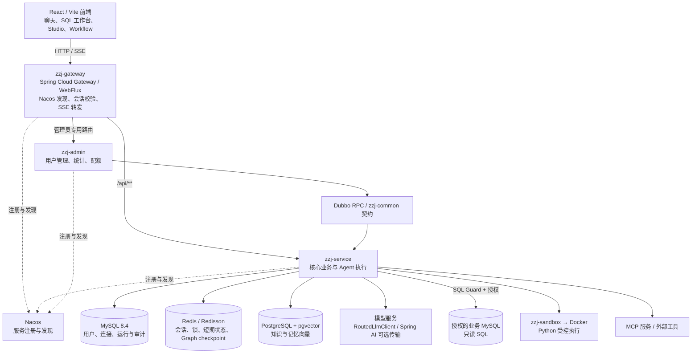
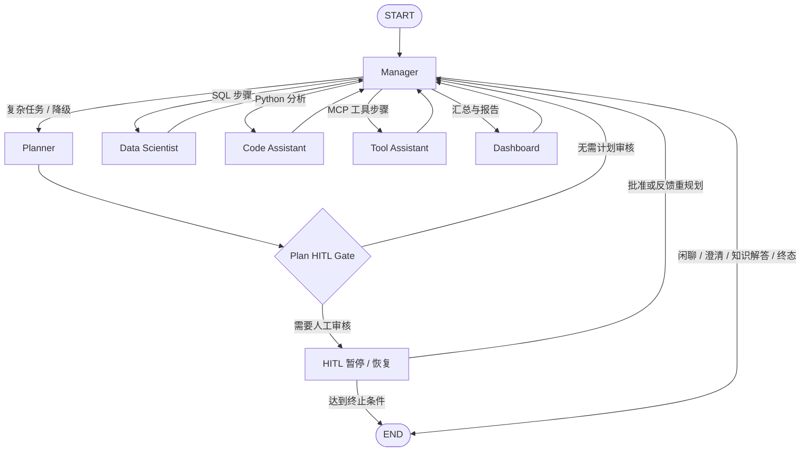
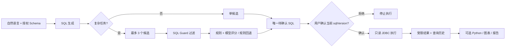

# ZZJ-NL2SQL · QueryForge

<p align="center">
  <strong>面向业务数据的 Multi-Agent 智能分析平台</strong><br>
  自然语言提问 → 安全 SQL 查询 → 多 Agent 协作分析 → 图表与报告
</p>

<p align="center">
  
  
  
  
  
  
  
</p>

<p align="center">
  <a href="https://github.com/zmzzj1/ZZJ-NL2SQL-front">前端仓库</a> ·
  <a href="https://github.com/zmzzj1/ZZJ-NL2SQL-backend">后端仓库</a> ·
  <a href="#-快速开始">快速开始</a> ·
  <a href="#-系统架构">系统架构</a> ·
  <a href="#-核心-api">核心 API</a>
</p>

> **项目定位**：将数据库连接、自然语言理解、SQL 生成与审批、数据分析、图表报告、工作流及模型治理整合为一套可追踪的后端系统。重点不是让模型“直接执行任意 SQL”，而是在用户授权范围内完成**可审核、可恢复、可观测**的数据分析任务。
>
>
> **代码基线**：本文以 `main` 分支的 [`003f16f`](https://github.com/zmzzj1/ZZJ-NL2SQL-backend/commit/003f16f39f904141a7d2bb81e26bee80fb7829af)（2026-10-24）为依据。功能说明对应已有实现；运行效果取决于数据库、模型服务及 Docker 等实际环境。

---

## 📖 项目简介

**ZZJ-NL2SQL（QueryForge）** 是一套面向结构化数据的 AI 分析平台。用户无需预先编写复杂 SQL，可以连接自己有权限访问的 MySQL 数据源，直接提出业务问题，由系统理解 Schema 与业务知识、选择任务执行路径、生成只读查询，并根据需求执行后续数据分析和报告生成。

例如，用户可以提问：

> “统计最近 30 天各类商品的订单金额，按周分析变化趋势，并生成一份包含异常波动说明的报告。”

系统会结合真实授权的 Schema 和上下文决定执行路径。需要复杂分析时，Planner 拆解任务，Data Scientist 负责生成与验证 SQL，Code Assistant 对已批准的查询结果进行隔离分析，Dashboard 汇总结果；数据库查询始终受只读 Guard、访问权限和人工确认约束。

平台同时提供 SQL 工作台、多数据源连接管理、查询历史、知识与记忆管理、MCP 工具、工作流编排、定时分析以及管理员治理能力。前端使用独立仓库 [ZZJ-NL2SQL-front](https://github.com/zmzzj1/ZZJ-NL2SQL-front)，本仓库专注后端与本地容器编排。

## ✨ 核心能力

| 功能域 | 已实现能力 |
| --- | --- |
| **Multi-Agent 分析** | Manager 任务路由、Planner 计划拆解、SQL / 代码 / 工具专业 Worker、Dashboard 汇总；基于 StateGraph 编排，SSE 输出执行轨迹 |
| **NL2SQL 与 SQL 工作台** | 根据真实 Schema 生成 SQL，JSQLParser 只读检查，查询执行、结果预览、历史记录与 CSV 安全导出 |
| **复杂 SQL 候选选优** | 复杂任务最多生成 3 个候选；先经 SQL Guard 过滤，再结合规则与模型评分选出唯一待审批 SQL；模型评分失败时按规则降级 |
| **Human-in-the-Loop** | SQL 逐版本确认；复杂计划可选择风险审核、批准、拒绝反馈及重新规划；审批状态与执行事实持久化 |
| **Python 隔离分析** | 仅对服务端授权的数据执行 Python；Docker 一次性容器、禁网、非 root、只读根文件系统、资源与超时限制 |
| **图表与 HTML 报告** | 表格、柱状图、折线图、饼图等结构化结果；分析产物记录、HTML 净化与受限预览 |
| **知识与长期记忆** | 业务术语、问答示例、关键词 / pgvector / RRF 混合检索；个人与工作空间记忆、来源与版本追溯 |
| **上下文管理** | L1–L4 分层构建、摘要与按需检索，在预算内优先保留授权边界、审批状态和已确认事实 |
| **MCP 工具系统** | 服务端工具目录、用户级 MCP Server 管理、STDIO / 远程 SSE 连接、动态发现、参数校验、工具权限与输出脱敏 |
| **Workflow 与 Schedule** | 可视化 DAG 定义、版本校验、执行历史、节点审批暂停/恢复；Cron、时区、租约与重复触发控制 |
| **Agent Studio / Skills** | Agent 草稿配置、发布版本、回滚、工具白名单、RAG / Memory 策略、技能模板与运行时选择 |
| **工作空间与平台治理** | OWNER / ADMIN / EDITOR / VIEWER 权限；模型路由、授权、配额、调用审计、平台用户与账号状态管理 |

### 设计关注点

- **模型输出不等于执行许可**：生成的 SQL 只有通过语法/安全校验、资源鉴权和明确审批后才能查询真实数据。
- **编排状态与业务事实分开**：StateGraph 与 Redis checkpoint 负责推进和恢复；MySQL 保存运行、步骤、审批、产物及审计事实，减少重复操作造成的副作用。
- **高风险执行失败关闭**：Docker 沙箱不可用不转到宿主机；远程工具与数据源必须经过受控地址及权限检查。
- **入口职责清晰**：Gateway 处理服务发现、路径转发和会话校验；Service 保留业务鉴权；Admin 通过 Dubbo RPC 访问业务数据，不直接复制核心数据库访问逻辑。
- **可解释的过程反馈**：SSE 逐步返回路由、计划、审批、Worker、节点、分析及报告事件，而不仅是最终文本。

---

## 🏗️ 系统架构

### 整体架构



### 服务与模块边界

| Maven 模块 | 默认端口 | 职责 |
| --- | --- | --- |
| `zzj-gateway` | `8080` | 面向浏览器的统一 `/api/**` 入口、Nacos + LoadBalancer、SSE 超时配置、Redis 登录态只读校验 |
| `zzj-service` | `8081` | Agent、SQL、连接、知识、工作流、报表、模型、权限等核心业务；默认仅监听本机回环地址 |
| `zzj-admin` | `8083` | 管理员用户列表、平台概览、账号状态、Token 配额，通过 Dubbo 消费核心业务能力 |
| `zzj-common` | — | Admin 与 Service 共用的 RPC 接口和序列化 DTO，不承载业务运行时 |
| `zzj-sandbox` | — | 与 Spring 无关的普通 JAR；封装 Docker Python 执行、限制、清理与错误分类 |

**网关边界**：精确的管理员路由转发至 `zzj-admin`，其他业务路由转发至 `zzj-service`。Gateway 不签发身份、不透传客户端自填的可信用户/角色头，也不会自动重试带副作用的 POST；业务服务继续独立校验资源和操作权限。

### Multi-Agent 执行图

主链路通过 Spring AI Alibaba Graph 的 `StateGraph / CompiledGraph` 编排；图的节点、条件边和终态由 [`AgentGraphFactory`](zzj-service/src/main/java/com/queryforge/application/agent/runtime/AgentGraphFactory.java) 定义。



> 图中的 **HITL Gate 是计划级审核**；**SQL 的逐版本审批是独立的业务边界**。即使 `autoConfirm=true` 跳过可选计划审核，也不会自动放行 SQL。

| Agent / 组件 | 责任 | 代码入口 |
| --- | --- | --- |
| **Manager** | 结合问题、授权 Schema、知识和压缩历史分类；调度步骤、汇总状态及决定终态 | [`ManagerRouter`](zzj-service/src/main/java/com/queryforge/application/agent/ManagerRouter.java)、[`AgentGraphNodes`](zzj-service/src/main/java/com/queryforge/application/agent/runtime/AgentGraphNodes.java) |
| **Planner** | 将复杂请求拆成有角色和依赖关系的执行计划；支持拒绝反馈重规划 | [`AgentPlanner`](zzj-service/src/main/java/com/queryforge/application/agent/AgentPlanner.java) |
| **Data Scientist** | SQL 生成、候选筛选与审批前准备，调用受控查询能力 | [`DataScientistWorkerAction`](zzj-service/src/main/java/com/queryforge/application/agent/runtime/worker/DataScientistWorkerAction.java) |
| **Code Assistant** | 对已授权、已执行的数据运行 Python 分析并保存产物 | [`CodeAssistantWorkerAction`](zzj-service/src/main/java/com/queryforge/application/agent/runtime/worker/CodeAssistantWorkerAction.java) |
| **Tool Assistant** | 按注册目录和权限规则调用 MCP / 内置工具 | [`ToolAssistantWorkerAction`](zzj-service/src/main/java/com/queryforge/application/agent/runtime/worker/ToolAssistantWorkerAction.java) |
| **Dashboard** | 消费前序步骤结果，生成或汇总报表与最终回答 | [`DashboardWorkerAction`](zzj-service/src/main/java/com/queryforge/application/agent/runtime/worker/DashboardWorkerAction.java) |

#### 路由策略

| 路由 | 典型问题 | 后续路径 |
| --- | --- | --- |
| `CHITCHAT` | 闲聊、能力咨询 | Manager 直接回答 |
| `CLARIFY` | 业务条件不足 | 返回澄清请求，不猜测 SQL |
| `KNOWLEDGE` | 授权知识问答 | 知识解释路径 |
| `SIMPLE` | 单条查询即可回答 | SQL 单候选路径 |
| `COMPLEX` | 多步数据分析、图表或报告 | Planner → 专业 Worker → Dashboard |
| `MEDIUM` | 分类器异常、超时或无法确定 | 安全降级进入 Planner |
| `TOOL_INVOCATION` | 用户在界面显式选择工具 | 跳过分类模型，执行一次受控工具调用 |

### 从提问到结果的完整链路

1. **请求进入**：前端携带会话及数据源 ID 请求 `/api/v1/agent/runs/stream`，Gateway 验证已有登录态并转发 SSE。
2. **鉴权与上下文构建**：Service 校验用户、会话、数据源和工作空间归属，加载 Schema、近期对话、知识、记忆和 Skill。
3. **Manager 路由**：判断是闲聊、澄清、简单 SQL、复杂分析还是用户显式工具；分类失败会进入受控的 Planner 路径。
4. **计划与可选审核**：复杂任务分解为结构化步骤；开启计划审核时，风险 Gate 可将运行停在 HITL，等待批准或拒绝反馈。
5. **执行专业步骤**：Worker 执行受限的 `Thinking → Review → Act → Verify` 循环；SQL 先生成唯一候选并等待用户批准。
6. **分析与报告**：获批 SQL 的实际查询结果才可流向下游 Python；图表和报告通过持久化工件关联回原始步骤。
7. **流式展示与恢复**：每个节点产生 SSE 事件；MySQL 保存执行事实，Redis checkpoint 记录图位置，前端可读取运行详情并继续待审核操作。

### 可恢复执行与 Worker 消息总线

- **StateGraph checkpoint**：[`AgentGraphRunner`](zzj-service/src/main/java/com/queryforge/application/agent/runtime/AgentGraphRunner.java) 将 `RedisSaver` 注入编译配置，以 `threadId` 关联 Run；计划级审核使用 `interruptBefore(HITL)` 暂停，并在同一线程状态上恢复。
- **幂等与一致性**：审批使用 Run / Step 归属、计划版本或 `sqlVersion`、数据库状态更新和受控领取约束；重复提交不应触发同一步骤重复执行。
- **Worker Loop**：统一执行确定性 Review、动作调用和结果 Verify；只有标为可恢复的失败才进行有界重试，不盲重试可能产生副作用的外部操作。
- **进程内 Bus**：通过 [`WorkerDispatcher`](zzj-service/src/main/java/com/queryforge/application/agent/runtime/bus/WorkerDispatcher.java) 支持以下三种分派方式：

| `app.agent.dispatch-mode` | 行为 | 适用用途 |
| --- | --- | --- |
| `OFF`（默认） | 直接调用 WorkerExecutor | 默认运行 |
| `BYPASS` | 正常执行仍走直调，同时镜像派发/结果事件；旁路不重复执行 Worker | 观察和校验总线契约 |
| `SWITCH` | 由 In-JVM Bus 端点队列接收任务，并等待真正的 Worker 回复 | 验证总线中介执行路径 |

> **边界说明**：当前总线使用 JVM 内队列与订阅，**不是 Kafka、RabbitMQ 或跨进程持久化 MQ**。进程终止会丢失在途消息；恢复依赖业务状态与 Graph checkpoint，不宣称消息自身持久化。端点不可用、队列已满或等待结果超时时明确返回失败，不靠双路径重复执行业务来“兜底”。

---

## 🔐 SQL、数据与工具安全

### SQL 生成与执行



安全策略包括：

- `ReadOnlySqlGuard` 基于 JSQLParser 检查 SQL 类型与危险表达式，拒绝写操作及未授权访问；目标库账号还应仅授予 `SELECT`。
- 查询使用真实连接 ID 和用户归属，限制返回行数与执行时长；通过独立目标连接池执行，不将模型生成文本直接当作后台管理 SQL。
- 数据源连接密码采用 AES-256-GCM 加密保存，连接目标有允许的主机/端口范围，防止任意外连。
- 对于 Agent SQL 步骤，批准请求必须指向当前 `stepId` 与 `sqlVersion`；计划审核不能替代 SQL 审批。
- 查询历史 CSV 导出重新执行当前有权限的只读查询，并处理电子表格公式注入风险，不直接信任旧结果。

### Docker 沙箱

[`zzj-sandbox`](zzj-sandbox/src/main/java/com/zzj/sandbox/DockerPythonSandboxExecutor.java) 以普通 Java JAR 形式向业务服务提供 `SandboxExecutor` 接口：

```text
获批的受限数据结果
    → 生成 / 校验 Python 分析请求
    → 一次性 Docker 容器（无网络、非 root、只读根、去 capabilities）
    → 限制内存 / CPU / 进程 / 时长 / 输出
    → 受控输出目录读取结构化分析产物
    → 清理容器与临时文件 → 持久化分析结果
```

Docker 不可用、命令异常或超时时会拒绝执行，**不会自动回退到宿主机执行模型生成的代码**。沙箱隔离是风险缓解措施，而非对不可信代码的绝对安全保证。

### 权限、知识检索与 MCP

- **认证**：Sa-Token 负责登录态，Redisson/Redis 保存会话；Gateway 只读验证，Service 负责最终授权；HttpOnly Cookie 与 CSRF 规则独立生效。
- **工作空间**：OWNER、ADMIN、EDITOR、VIEWER 四级角色；共享 Agent、知识或 Skill 不自动授予他人的数据源访问权限。
- **RAG**：关键词检索、真实 Embedding + pgvector 余弦相似度、RRF 融合；按用户、数据源、工作空间执行候选过滤并记录来源与版本。
- **Memory / Skill**：记忆支持来源、类型、个人/空间作用域与禁用；Skill 是受限的提示词模板，不执行任意脚本、不扩展数据权限。
- **MCP**：工具发现、参数契约校验、角色和 Agent 白名单双层授权、递归脱敏；STDIO 限制为服务器预配置命令，远程地址经过出站 URL 安全检查。
- **模型治理**：模型 Provider / Profile、授权、路由策略、配额与调用指标统一由 `RoutedLlmClient` 管理；Spring AI ChatClient 可作为可选传输层，但不替代鉴权与治理逻辑。

---

## 🧰 技术栈

| 层次 | 主要技术 | 用途 |
| --- | --- | --- |
| Java 服务 | **Java 21、Spring Boot 3.5.6** | 核心业务与管理服务、虚拟线程 |
| 服务接入 | **Spring Cloud 2025.0.3、Spring Cloud Alibaba 2025.0.0.0、Gateway、Nacos** | WebFlux 网关、服务发现、负载均衡 |
| 服务通信 | **Apache Dubbo 3.3.6** | Admin ↔ Service 内部管理 RPC |
| Agent / LLM | **Spring AI 1.1.8、Spring AI Alibaba Graph 1.1.2.0** | 模型调用适配、StateGraph、RedisSaver |
| 数据访问 | **Spring JDBC、MyBatis-Plus 3.5.16、HikariCP、JSQLParser 5.3** | 业务只读查询、管理实体与 SQL 校验 |
| 主数据 | **MySQL 8.4** | 用户、连接、查询历史、Agent/工作流、配置和审计 |
| 缓存与协调 | **Redis 7.4、Redisson 4.6.1、Caffeine** | 会话、分布式锁、审批短期状态、checkpoint、Schema 缓存 |
| 向量检索 | **PostgreSQL 17 + pgvector** | 知识、问答与长期记忆的向量投影 |
| 认证安全 | **Sa-Token 1.44.0、Spring Security、AES-GCM** | 登录会话、请求安全、连接凭据保护 |
| 受控执行 | **Docker / Python 3.12** | 数据分析容器隔离及资源限制 |
| 测试与交付 | **JUnit 5、Mockito、Maven、Docker Compose** | 测试、构建和本地环境编排 |
| 配套前端 | **React 18、TypeScript、Vite 6、Tailwind CSS 4、Nginx** | 交互界面、SSE 时间线、容器化静态资源 |

## 📂 代码结构

```text
ZZJ-NL2SQL-backend/
├── pom.xml                         # Maven Reactor / 依赖与版本管理
├── zzj-service/                    # 核心业务服务
│   └── src/main/
│       ├── java/com/queryforge/
│       │   ├── application/
│       │   │   ├── agent/         # Manager / Planner / StepEngine / Graph / Worker
│       │   │   ├── query/         # SQL 生成、执行、CSV、历史
│       │   │   ├── datasource/    # 数据源管理
│       │   │   ├── analysis/      # 分析业务
│       │   │   ├── report/        # 报告
│       │   │   ├── rag/           # 混合知识检索
│       │   │   ├── memory/        # 长期记忆
│       │   │   ├── mcp/           # MCP 生命周期与调用
│       │   │   ├── workflow/      # 工作流执行
│       │   │   ├── schedule/      # Cron 调度
│       │   │   ├── model/         # 模型治理 / 路由
│       │   │   └── ...            # Studio / Skill / Workspace / Identity
│       │   ├── domain/            # 领域状态、契约、校验与模型
│       │   ├── infrastructure/    # MySQL、Redis、pgvector、LLM、Sandbox 适配
│       │   ├── trigger/           # REST Controller 与 RPC Provider
│       │   └── QueryForgeApplication.java
│       └── resources/
│           ├── application.yml
│           └── db/                # 版本化 SQL 初始化与增量脚本
├── zzj-gateway/                   # WebFlux Gateway / Nacos / 认证过滤
├── zzj-admin/                     # 管理 API / Dubbo Consumer
├── zzj-common/                    # 共享 RPC 契约与 DTO
├── zzj-sandbox/                   # 独立 Docker Python Sandbox JAR
├── docker/
│   ├── start.ps1                  # Windows 完整环境启动
│   ├── stop.ps1                   # 停止并保留数据卷
│   ├── .env.example
│   └── mysql-init/                # Compose 首次数据库初始化
├── tools/                         # 本地 LLM/MCP 测试桩与测试脚本
├── scripts/start-local.sh         # 本地启动辅助脚本
├── compose.yaml                   # MySQL / Redis / PostgreSQL / Nacos / 服务 / 前端
├── Dockerfile                     # Java 服务多阶段镜像
└── .env.example                   # 本机 Spring 属性示例
```

---

## 🚀 快速开始

### 环境要求

- **推荐方式**：Docker Desktop（Docker Engine + Compose v2），Git、PowerShell（Windows）。完整环境还需要配套前端源码。
- **本地独立启动**：JDK 21、Maven 3.9+、MySQL 8、Redis、PostgreSQL + pgvector、Nacos 3.2.x；模型分析需配置可用的 OpenAI 兼容 API。
- **沙箱**：只有 Docker 守护进程与所需 Python 镜像可用时才能执行隔离 Python 分析。

### 方式一：Docker Compose（Windows 推荐）

**1. 拉取前后端到同级目录**（`compose.yaml` 使用 `../frontend` 构建前端）：

```powershell
mkdir ZZJ-NL2SQL
cd ZZJ-NL2SQL
git clone https://github.com/zmzzj1/ZZJ-NL2SQL-backend.git backend
git clone https://github.com/zmzzj1/ZZJ-NL2SQL-front.git frontend
cd backend
```

**2. 创建本地配置**：

```powershell
New-Item -ItemType Directory -Force config | Out-Null
Copy-Item .env.example config/local.properties
```

编辑 `config/local.properties`，至少设置 `app.security.encryption-key` 为**随机 32 字节密钥的 Base64**，并按实际模型提供商填入 `app.llm.api-key`、`app.llm.base-url`、`app.llm.model`；若使用向量检索，还需配置可用的 Embedding 参数。

**注意 Compose 的数据库地址**：`.env.example` 示例文件包含 `app.management.url=jdbc:mysql://127.0.0.1:3306/...`、固定用户名及占位密码。**使用 Docker Compose 时，请从 `config/local.properties` 中删除这三项 `app.management.url`、`app.management.username`、`app.management.password`**，让 `application.yml` 中的 `MANAGEMENT_DB_URL / MANAGEMENT_DB_USERNAME / MANAGEMENT_DB_PASSWORD` 读取 Compose 提供的 `mysql` 服务地址和随机密码；否则外部配置可能覆盖容器环境对应的默认占位值。独立本地 Java 启动才需要按自己的 MySQL 地址填写这三项。

PowerShell 生成密钥示例：

```powershell
$bytes = New-Object byte[] 32
[Security.Cryptography.RandomNumberGenerator]::Create().GetBytes($bytes)
[Convert]::ToBase64String($bytes)
```

使用 Compose 网络中的演示 MySQL 数据源时，可在 `config/local.properties` 中将 `mysql` **显式添加到受信主机列表**，例如：

```properties
app.connection-policy.allowed-hosts=127.0.0.1,localhost,mysql
```

**3. 启动完整环境**：

```powershell
powershell -ExecutionPolicy Bypass -File .\docker\start.ps1
```

脚本会在缺少 `docker/.env` 时生成本地随机数据库密码，检测容器环境与端口冲突，然后执行 `docker compose up -d --build --wait`。MySQL 迁移、演示数据库、PostgreSQL 向量表通过初始化脚本在**首次创建数据卷**时执行。

**4. 访问服务**：

| 地址 | 服务 |
| --- | --- |
| `http://127.0.0.1:5174/` | 前端页面（Nginx） |
| `http://127.0.0.1:8080/api/health` | 经 Gateway 的业务健康检查 |
| `http://127.0.0.1:8080/actuator/health` | Gateway 健康检查 |
| `http://127.0.0.1:8082/` | Nacos 控制台（本地开发环境） |
| `http://127.0.0.1:8083/actuator/health` | Admin 健康检查 |

**5. 停止**（默认保留 MySQL / PostgreSQL / Redis / Nacos named volumes）：

```powershell
powershell -ExecutionPolicy Bypass -File .\docker\stop.ps1
```

macOS / Linux 可在创建 `docker/.env`（参考 `docker/.env.example`，填入强密码）及 `config/local.properties` 后，直接从 `backend/` 执行：

```bash
docker compose --env-file docker/.env up -d --build --wait
docker compose --env-file docker/.env ps
docker compose --env-file docker/.env down
```

> **开发环境提示**：Compose 中 `zzj-service` 挂载 Docker socket 以启动隔离分析容器，这对宿主 Docker 拥有高权限；Nacos 示例关闭了认证，服务也映射了部分内部端口。该编排适用于**可信本地开发**，不要不加加固直接用于公网生产部署。基础镜像首次拉取可能受 Docker Hub 网络连通性影响。

### 方式二：本地 Maven 启动

先在本机准备好 **MySQL、Redis、PostgreSQL + pgvector、Nacos**。在后端仓库根目录创建 `config/local.properties` 并填写管理库连接、加密密钥、模型与向量服务配置；本地启动时不依赖前端 Docker 构建。

**初始化数据库**（首次搭建；在 `backend/` 执行）：

```bash
# 先创建管理数据库和演示数据源
mysql -h 127.0.0.1 -u root -p < zzj-service/src/main/resources/db/02-management-schema.sql
mysql -h 127.0.0.1 -u root -p < zzj-service/src/main/resources/db/03-test-databases.sql

# 后续增量脚本应按固定顺序执行至最新版本
# 完整、权威的文件顺序见 docker/mysql-init/10-init-queryforge.sh
# 同时为平台应用账号授权 sql_platform，为演示只读账号仅授予 SELECT

# 在 PostgreSQL 中创建 rageng 库，安装 vector 扩展并建向量表
psql -U postgres -d rageng -f zzj-service/src/main/resources/db/13-p12-pgvector.sql
```

管理员应单独创建 `platform_app` 等数据库用户并授予最小必要权限；数据库账号、密码和加密密钥**不要提交到仓库**。对于已经使用过的数据库，不应重放首次初始化脚本覆盖现有数据，需按迁移历史核对后执行必要增量。

**构建与运行**（以下 `java -jar` 命令在不同终端分别执行）：

```bash
# 先启动 Nacos、MySQL、Redis、PostgreSQL，并保证配置与地址对应
./mvnw verify

# 终端 1：核心业务 Service
java -jar zzj-service/target/zzj-service.jar

# 终端 2：管理服务（依赖 Service 的 Dubbo Provider）
java -jar zzj-admin/target/zzj-admin.jar

# 终端 3：Gateway
java -jar zzj-gateway/target/zzj-gateway.jar
```

**重要**：工作目录统一保持在 `backend/`，因为 `config/local.properties` 与 `tools/mcp-echo-server.mjs` 使用相对路径。服务默认 Nacos 地址为 `127.0.0.1:8848`，Service 默认监听 `127.0.0.1:8081`，Admin 默认监听 `127.0.0.1:8083`；浏览器与前端开发服务统一通过 Gateway `http://127.0.0.1:8080` 调用 API。当前仓库未配置 Flyway 自动迁移。

### 本地模型测试桩

仓库还提供 `tools/llm-stub.mjs` 与 `tools/mcp-echo-server.mjs` 供部分确定性测试及本地调试。它们不等于真实大模型或真实外部 MCP 服务；应按测试需求配置对应地址，不能把桩的输出当作实际 LLM 效果。

---

## ⚙️ 核心配置

核心属性位于 [`zzj-service/src/main/resources/application.yml`](zzj-service/src/main/resources/application.yml)，本地密钥建议放入 `.gitignore` 忽略的 `config/local.properties`。环境变量可以覆盖应用默认值。

| 配置 / 环境变量 | 说明 |
| --- | --- |
| `MANAGEMENT_DB_URL` / `MANAGEMENT_DB_USERNAME` / `MANAGEMENT_DB_PASSWORD` | MySQL 管理库连接，存储用户与平台元数据 |
| `APP_ENCRYPTION_KEY` | 32 字节 Base64 密钥；用于数据源凭据加密 |
| `REDIS_HOST` / `REDIS_PORT` | Redis 会话、状态与协调存储 |
| `PG_URL` / `PG_USERNAME` / `PG_PASSWORD` | PostgreSQL + pgvector 数据源 |
| `NACOS_SERVER_ADDR` | Nacos Discovery / Dubbo 注册中心 |
| `LLM_BASE_URL` / `LLM_API_KEY` / `LLM_MODEL` | OpenAI 兼容大模型服务 |
| `EMBEDDING_BASE_URL` / `EMBEDDING_API_KEY` / `EMBEDDING_MODEL` | Embedding 服务，供向量/混合检索 |
| `CONNECTION_ALLOWED_HOSTS` / `CONNECTION_ALLOWED_PORTS` | 用户数据源可连接的主机/端口白名单 |
| `SQL_MAX_ROWS` / `SQL_QUERY_TIMEOUT_SECONDS` | SQL 查询结果行数与超时上限 |
| `AGENT_MAX_STEPS` / `AGENT_MAX_LLM_CALLS` | 单次 Agent 计划步骤数与模型调用预算 |
| `AGENT_MAX_REPAIRS` | SQL 修复次数限制 |
| `ANALYSIS_SANDBOX_IMAGE` / `ANALYSIS_TIMEOUT_SECONDS` | Docker Python 镜像与执行超时 |
| `SCHEDULE_POLL_INTERVAL_MS` / `SCHEDULE_LEASE_SECONDS` | 定时任务轮询周期与租约 |
| `app.agent.dispatch-mode` | Worker 分派：`OFF` / `BYPASS` / `SWITCH`，默认 `OFF` |
| `app.agent.max-worker-attempts` | Worker 受控执行尝试次数，代码默认最多 2 次 |
| `app.llm.use-spring-ai` | 是否以 Spring AI ChatClient 承载底层模型请求；统一模型治理入口保持不变 |

模型 API Key 留空时，SQL 生成和依赖模型的 Agent 能力无法正常工作；普通健康检查不代表模型可用。Embedding / pgvector 不可用时，也不应将关键词检索结果描述成向量检索结果。

---

## 🔌 核心 API

统一经 `http://127.0.0.1:8080` 的 Gateway 访问。除下表注明的匿名端点，其余业务接口依赖登录态、CSRF 及资源授权；流式请求以 `text/event-stream` 返回。

| 领域 | 方法 | 路径 | 作用 |
| --- | --- | --- | --- |
| 认证 | `POST` | `/api/v1/auth/register` | 注册（匿名） |
| 认证 | `POST` | `/api/v1/auth/login` | 登录并创建会话（匿名） |
| 认证 | `GET` | `/api/v1/auth/me` | 当前用户 |
| 认证 | `GET` | `/api/v1/auth/csrf` | CSRF Token（匿名） |
| 数据源 | `GET / POST` | `/api/v1/connections` | 连接列表 / 新建 |
| 数据源 | `POST` | `/api/v1/connections/{id}/test` | 数据库连通性测试 |
| 数据源 | `GET` | `/api/v1/connections/{id}/schema` | 读取授权 Schema |
| SQL | `POST` | `/api/v1/sql/generate/stream` | 流式生成 SQL |
| SQL | `POST` | `/api/v1/sql/execute` | 执行只读 SQL |
| 历史 | `GET` | `/api/v1/query-history/{id}/export` | 安全导出 CSV |
| 对话 | `GET / POST` | `/api/v1/conversations` | 会话列表 / 创建 |
| Agent | `POST` | `/api/v1/agent/runs/stream` | 创建并运行 Agent（SSE） |
| Agent | `GET` | `/api/v1/agent/runs/{runId}` | 查询运行状态、步骤及工件 |
| Agent | `GET` | `/api/v1/agent/runs/latest?conversationId=...` | 恢复最近一次运行视图 |
| Agent | `POST` | `/api/v1/agent/runs/{runId}/steps/{stepId}/approve/stream` | SQL 版本审批与续跑 |
| Agent | `POST` | `/api/v1/agent/runs/{runId}/steps/{stepId}/reject` | 拒绝 SQL 步骤 |
| Agent | `POST` | `/api/v1/agent/runs/{runId}/plan/continue/stream` | 计划审批 / 反馈重规划 |
| Agent | `POST` | `/api/v1/agent/runs/{runId}/cancel` | 取消运行 |
| 分析 | `POST` | `/api/v1/analysis/runs/stream` | 隔离分析并输出 SSE |
| 报告 | `GET` | `/api/v1/reports/{id}/preview` | 受控 HTML 预览 |
| 知识 | `POST` | `/api/v1/knowledge/search` | 关键词 / 向量 / 混合检索 |
| 工具 | `GET / POST` | `/api/v1/tools`、`/api/v1/tools/invoke` | 工具列表 / 受控调用 |
| MCP | `GET / POST` | `/api/v1/mcp-servers` | 用户级 MCP Server 管理 |
| Workflow | `POST` | `/api/v1/workflows/{id}/runs/stream` | 运行工作流（SSE） |
| Workflow | `POST` | `/api/v1/workflows/runs/{runId}/nodes/{nodeId}/approve/stream` | 审批工作流节点并继续 |
| 定时任务 | `GET / POST` | `/api/v1/schedules` | 定时计划查询 / 创建 |
| Studio | `GET / POST` | `/api/v1/studio/agents` | Agent 配置管理 |
| Skills | `GET / POST` | `/api/v1/skills` | Skill Registry |
| 工作空间 | `GET / POST` | `/api/v1/workspaces` | 空间及角色授权 |
| 记忆 | `GET / POST` | `/api/v1/memories` | 长期记忆管理 |
| 管理 | `GET` | `/api/v1/admin/users`、`/api/v1/admin/dashboard` | 管理员用户分页 / 平台概览 |
| 管理 | `PUT` | `/api/v1/admin/users/{userId}/status` | 用户启停 |
| 管理 | `PUT` | `/api/v1/admin/users/{userId}/quota` | Token 配额调整 |

### Agent 请求示例

创建运行的主要字段来自 [`CreateAgentRunRequest`](zzj-service/src/main/java/com/queryforge/domain/agent/CreateAgentRunRequest.java)：

```json
{
  "conversationId": 1,
  "connectionId": 1,
  "userInput": "统计最近30天各类商品的销售金额并分析趋势",
  "autoConfirm": false
}
```

通过 `POST /api/v1/agent/runs/stream` 提交，实际调用需要有效的登录 Cookie 与 CSRF Token。`autoConfirm=false` 允许复杂计划进入风险审核；它不改变 SQL 的逐版本审批要求。示例中的 ID 仅为占位值，必须替换为当前账户已授权的真实 ID。

计划审核提交形如：

```json
{
  "approved": false,
  "hitlVersion": 2,
  "feedback": "请把分析范围改为最近7天，并按地区拆分"
}
```

SQL 审批只确认前端展示过的版本：

```json
{
  "sqlVersion": 1,
  "confirm": true,
  "clientRequestId": "example-request-001"
}
```

### SSE 事件

Agent 时间线会产生如 `run.started`、`agent.routed`、`plan.ready`、`plan.review_required`、`step.sql_ready`、`approval.required`、`step.succeeded`、`analysis.succeeded`、`report.ready`、`run.completed`、`run.failed`、`node.*`、`worker.thinking`、`bus.dispatched` 等事件（以相应路径实际执行、当前版本实现和条件触发为准）。事件体由后端结构化 DTO 序列化，前端不应把“事件已送达”直接解释为“外部动作已成功”。

---

## 🧪 测试与验证

```bash
# 父工程：全部 Maven 模块单元测试与生命周期校验
./mvnw verify

# 单独验证 Sandbox 及其上游依赖
./mvnw -pl zzj-sandbox -am test

# 前端仓库（独立目录）
npm run check
```

**已有验证记录**（来自仓库原 README，非本文件生成时重新运行的 CI）：

| 基线 | 测试记录 | 重点 |
| --- | --- | --- |
| `003f16f` 附近的 2026-10-24 验证 | **615 个自动化用例，0 failures、0 errors、21 skipped** | StateGraph 运行、checkpoint 恢复、Worker Bus、HITL 并发、兼容接口 |
| 前一阶段 2026-10-23 验证 | **561 个用例，0 failures、0 errors、22 skipped** | SQL 多候选、角色分派、审批 SQL 与 Python / 报告依赖链 |
| Admin 定向联调记录 | **23 / 23** 场景通过 | Gateway → Admin → Dubbo → Service → MySQL、用户状态、会话与配额 |

主要测试覆盖：SQL Guard 与只读执行、用户/空间权限、Manager 安全降级、SQL 版本审批、计划审核的并发/重复操作、StateGraph 节点推进、Worker Bus 三模式、MCP 参数与权限、沙箱安全参数、RAG/Memory、调度租约及接口兼容性。**环境依赖型测试在 MySQL / PostgreSQL / Redis / Docker 不可用时可能跳过**；单元测试通过不等于真实模型效果、安全隔离和完整部署已通过端到端验收。运行结论以自己的测试报告为准。

## ⚠️ 当前限制与部署说明

1. **只读分析优先**：业务 SQL 不提供通用的任意写入能力，所有分析请求必须受 SQL Guard、权限与审批限制。
2. **模型与 Embedding 服务外部依赖**：不同兼容 API 的响应格式和工具能力可能不同，需使用真实服务验证；无可用密钥无法完整体验 Agent。
3. **消息总线不持久化**：当前 In-JVM Bus 用于同进程 Worker 分派与迁移验证，不提供跨节点消息可靠投递承诺。
4. **数据库脚本不是自动迁移框架**：MySQL 初始化脚本在新数据卷首次创建时运行；已有数据卷上的结构更新必须经过单独迁移管理。
5. **Compose 面向可信开发环境**：Docker socket、Nacos 匿名访问及内部端口映射必须在生产部署前调整并进行安全审计；服务容器通过宿主 Docker daemon 创建沙箱时还需检查临时目录挂载路径一致性，不能只凭 Docker socket 可用就认定 Python 沙箱端到端通过。
6. **运行评测与代码版本要对应**：测试数字是指定时间点的记录，不能视为后续任何提交自动通过。

---

## 🔗 相关仓库与源码入口

- **后端**：[zmzzj1/ZZJ-NL2SQL-backend](https://github.com/zmzzj1/ZZJ-NL2SQL-backend)
- **前端**：[zmzzj1/ZZJ-NL2SQL-front](https://github.com/zmzzj1/ZZJ-NL2SQL-front)
- **Agent 图构建**：[`AgentGraphFactory`](zzj-service/src/main/java/com/queryforge/application/agent/runtime/AgentGraphFactory.java)
- **Agent 执行与恢复**：[`AgentGraphRunner`](zzj-service/src/main/java/com/queryforge/application/agent/runtime/AgentGraphRunner.java)
- **Agent API / SSE**：[`AgentRunController`](zzj-service/src/main/java/com/queryforge/trigger/agent/AgentRunController.java)、[`AgentStreamEvents`](zzj-service/src/main/java/com/queryforge/domain/agent/AgentStreamEvents.java)
- **SQL 候选选择**：[`SqlCandidateSelectionService`](zzj-service/src/main/java/com/queryforge/application/agent/sql/SqlCandidateSelectionService.java)
- **Python 沙箱**：[`DockerPythonSandboxExecutor`](zzj-sandbox/src/main/java/com/zzj/sandbox/DockerPythonSandboxExecutor.java)
- **本地完整部署**：[`compose.yaml`](compose.yaml)

> **许可说明**：截至以上代码基线，仓库根目录未发现 `LICENSE` 文件。请勿仅根据所使用的开源依赖推断本项目采用 MIT 或其他许可证；如计划公开授权或接受外部贡献，应单独添加明确的许可文件。
